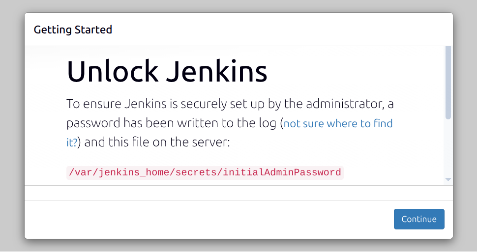
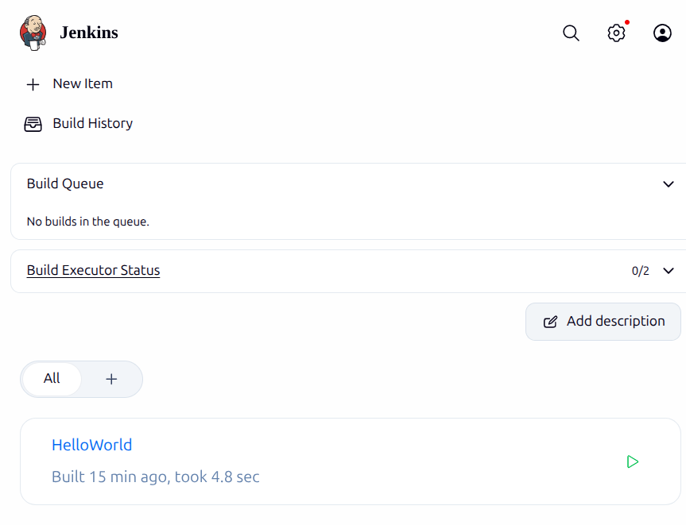

# Exercise 7: Jenkins CI Installation

## Objective

Install Jenkins with Docker, retrieve its initial unlock password, and access the Jenkins dashboard.

Evidence was captured on Linux with Docker Engine 29.8.0 on 2026-10-15. Jenkins remains available at [http://localhost:8080](http://localhost:8080).

## Files

- [compose.yaml](compose.yaml): runs Jenkins LTS with persistent storage and localhost-only web/agent ports.
- [screenshots/jenkins-unlock.png](screenshots/jenkins-unlock.png): captured initial unlock screen.

## 1. Validate the Configuration

```bash
docker compose config --quiet
```

Final result:

```text
Compose configuration: valid
```

## 2. Start Jenkins

```bash
docker compose up -d
```

Final result:

```text
Container jenkins-exercise-7 Started
```

## 3. Verify Jenkins Is Running

```bash
docker compose ps
```

Captured output:

```text
NAME                 IMAGE                 STATUS         PORTS
jenkins-exercise-7   jenkins/jenkins:lts   Up             127.0.0.1:8080->8080/tcp, 127.0.0.1:50000->50000/tcp
```

Jenkins version: `2.580.1`. Java runtime: `OpenJDK 21.0.12.1`.

## 4. Unlock Jenkins

The initial administrator password is generated at:

```text
/var/jenkins_home/secrets/initialAdminPassword
```

Confirm the file exists without displaying its secret:

```bash
docker exec jenkins-exercise-7 sh -c \
  'test -s /var/jenkins_home/secrets/initialAdminPassword && echo "Initial admin password file exists"'
```

Captured result:

```text
Initial admin password file exists
```

Read the password directly in your terminal when needed:

```bash
docker exec jenkins-exercise-7 cat /var/jenkins_home/secrets/initialAdminPassword
```

The secret is intentionally not included in this README or screenshot.

## 5. Open Jenkins

Open [http://localhost:8080](http://localhost:8080), complete the setup wizard, and sign in with the administrator account you created.

Captured final access result:

```text
Jenkins version: 2.580.1
Dashboard: accessible at http://localhost:8080
Administrator session: signed in
```

Initial unlock screen:



Signed-in Jenkins dashboard showing the configured `HelloWorld` job:



## Cleanup

Stop Jenkins and remove its container/network while keeping its saved data:

```bash
docker compose down
```

Remove the saved Jenkins data volume as well:

```bash
docker compose down -v
```