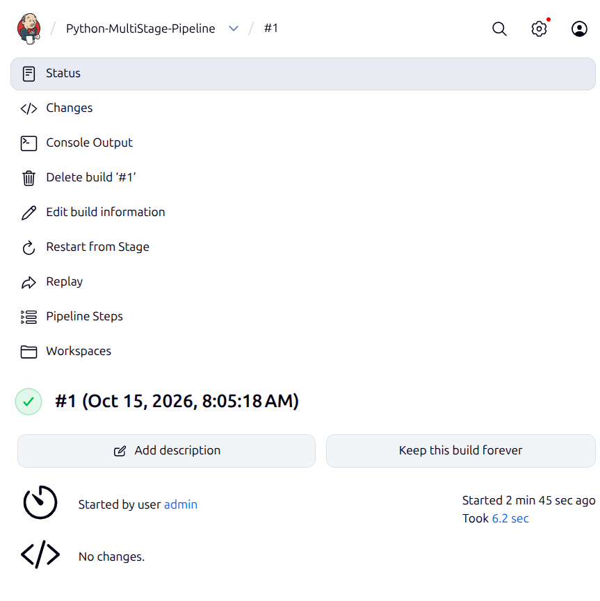
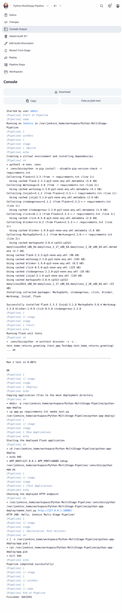

# Exercise 9: Jenkins Multi-Stage Pipeline

## Objective

Build, test, deploy, and smoke-test a Flask application using Jenkins Pipeline stages. The deployment target is a mock directory inside the Jenkins job workspace.

## Project Files

- [app.py](app.py): Flask endpoint returning the exercise greeting.
- [requirements.txt](requirements.txt): pinned Flask and Werkzeug dependencies.
- [test_app.py](test_app.py): unit test for the Flask route.
- [smoke_test.py](smoke_test.py): HTTP test for the deployed application.
- [Jenkinsfile](Jenkinsfile): Declarative Pipeline with build, test, deploy, run, and HTTP verification stages.
- [screenshots/pipeline-build-summary.png](screenshots/pipeline-build-summary.png): Jenkins build summary.
- [screenshots/pipeline-console.png](screenshots/pipeline-console.png): Jenkins console output for the successful run.

Evidence was captured on 2026-10-15 using Jenkins `2.580.1`, Python `3.13.5` in the Jenkins container, and Flask `2.3.3`.

## 1. Validate the Application Locally

Create an environment, install the pinned dependencies, and run the unit tests from this directory:

```bash
python3 -m venv .venv
.venv/bin/python -m pip install -r requirements.txt
.venv/bin/python -m unittest discover -v -s .
```

Captured output:

```text
test_home_returns_greeting (test_app.TestApp.test_home_returns_greeting) ... ok

Ran 1 test in 0.013s
OK
```

## 2. Configure and Run the Jenkins Pipeline

Jenkins job: [Python-MultiStage-Pipeline](http://localhost:8080/job/Python-MultiStage-Pipeline/).

The job uses the Declarative Pipeline stored in [Jenkinsfile](Jenkinsfile). For build `#1`, the application files were placed in the Jenkins job workspace and the same pipeline definition was saved in the job configuration. To make later builds reproducible from source control, push the Exercise-9 files and configure the job to use **Pipeline script from SCM** with this repository's `Jenkinsfile`.

## 3. Captured Pipeline Results

Build `#1` completed with `SUCCESS` in `6.2 sec`.

### Build

```text
Creating a virtual environment and installing dependencies
Successfully installed Flask-2.3.3 Werkzeug-2.3.8
```

### Test

```text
test_home_returns_greeting (test_app.TestApp.test_home_returns_greeting) ... ok
Ran 1 test in 0.007s
OK
```

### Deploy

The files were copied to:

```text
/var/jenkins_home/workspace/Python-MultiStage-Pipeline/python-app-deploy/
```

Captured deployment contents:

```text
app.py
requirements.txt
smoke_test.py
app.log
app.pid
```

### Run Application and Test Application

```text
Starting the deployed Flask application
Checking the deployed HTTP endpoint
HTTP 200: Hello, Jenkins Multi-Stage Pipeline!
```

The pipeline post action stopped the Flask process after the HTTP check.

### Final Pipeline Result

```text
Pipeline completed successfully!
Finished: SUCCESS
```

Jenkins build summary:



Jenkins console showing the unit test, deployment, HTTP response, cleanup, and final result:



## 4. Additional Enhancements

The source exercise lists these as optional extensions; they are not part of the captured build above.

- **Code quality checks:** add a `Code Quality` stage after `Build`, install `flake8` in the virtual environment, and run `.venv/bin/flake8 app.py test_app.py smoke_test.py` before the unit-test stage.
- **Container deployment:** build a Docker image for the Flask app and run it with a health check instead of copying to `python-app-deploy`. This requires a Dockerfile and Docker access for the Jenkins agent.
- **Notifications:** add a `post { success { ... } failure { ... } }` action using a configured Jenkins email or Slack plugin and credentials stored in Jenkins, not in the repository.

The exercise source does not contain a separate Q&A section.

## Result

The Jenkins multi-stage pipeline installed the application dependencies, passed its unit test, copied the application to the mock deployment directory, started the app, verified its HTTP response, and stopped the process. Build `#1` finished successfully.